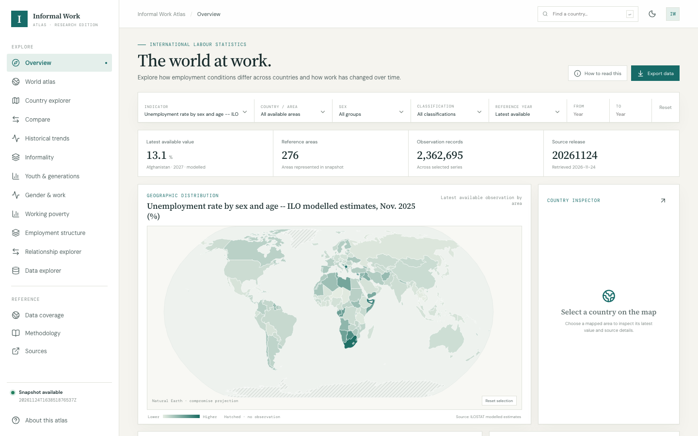
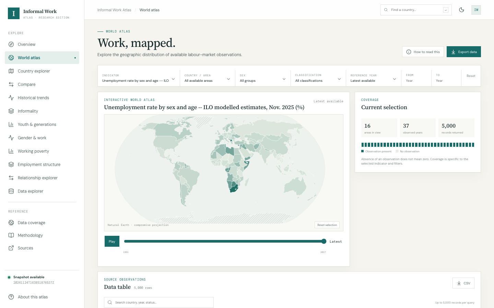
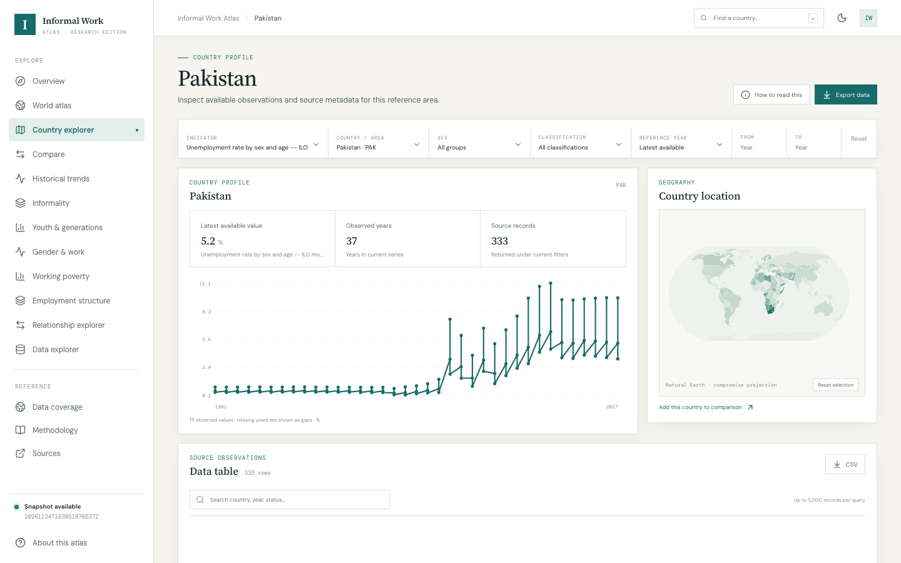
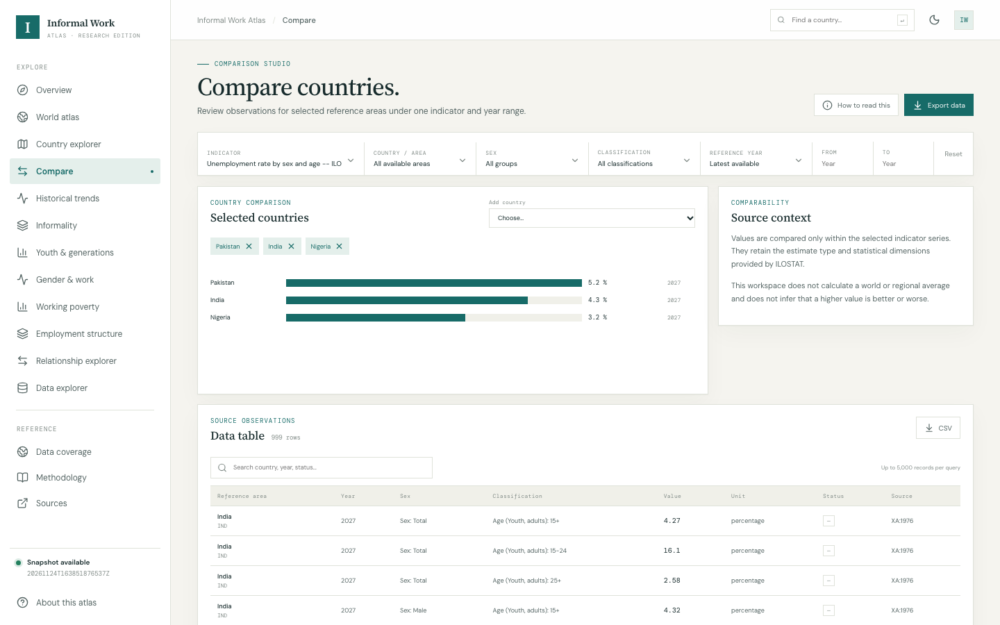
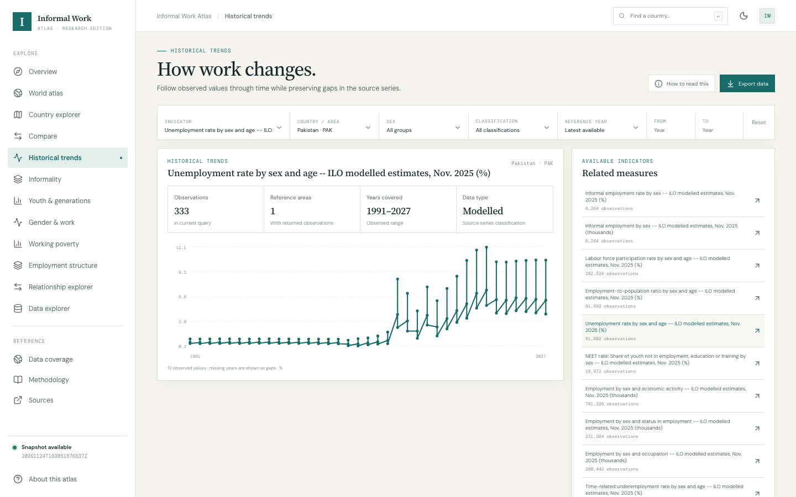
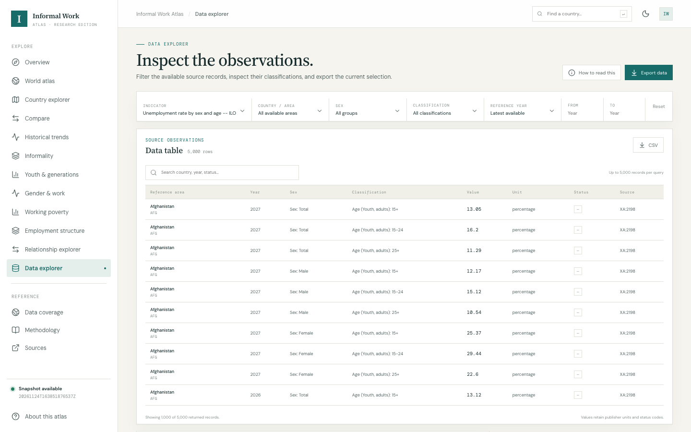
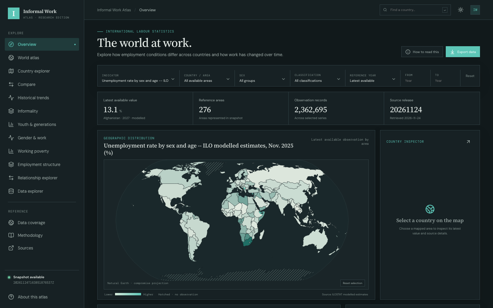
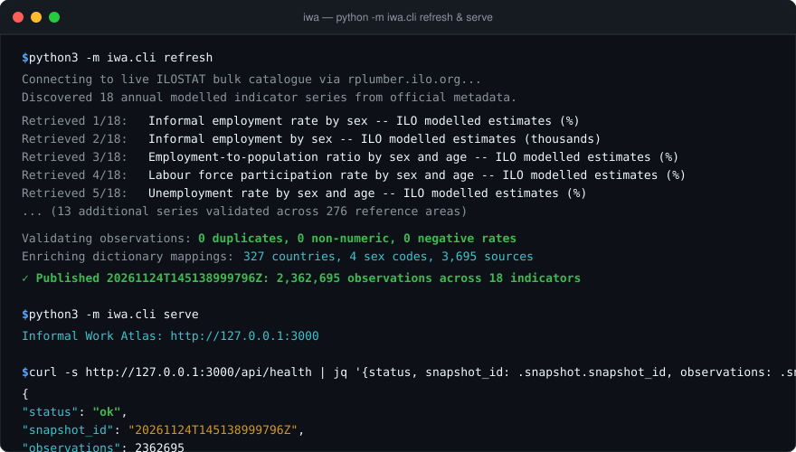

# Informal Work Atlas

**Understanding the world of work.** Informal Work Atlas is an independent statistical observatory and research interface for exploring official international labour statistics from the International Labour Organization (ILOSTAT). It keeps source series, estimate types, releases, units, classifications, and missing observations visible and verifiable.



---

## The Problem

International labour statistics are critical for understanding global development, economic vulnerability, and the future of work. However, official data often remains locked behind bulk download facilities, fragmented CSV tables, and complex classification schemes.

Too often, dashboards:

- Silently interpolate missing years or treat absent values as zero.
- Conflate modelled estimates with direct national household survey observations.
- Discard statistical provenance, source releases, and classification notes.
- Flatten multidimensional breakdowns (sex, age, sector, status) into misleading averages.

**Informal Work Atlas** solves this by providing a transparent, publication-grade analytical platform that renders official data with absolute statistical integrity. Missing observations remain explicit gaps, source releases and checksums are traceable to the second, and modelled indicators are clearly demarcated from reported metrics.

---

## Visual Showcase

### Global Overview & Choropleth Mapping

A global choropleth map powered by Natural Earth TopoJSON geometry and D3 Geo compromise projection. Features adaptive quantile color mapping, missing-observation hatch patterns, and instant country inspection.


### Interactive World Atlas & Temporal Timeline

Scrub through historical observations from 1991 to 2027 with automated timeline playback, regional availability summaries, and dynamic data tables.



### Country Explorer & Statistical Profiling

Drill down into individual reference areas (e.g., Pakistan, Afghanistan, Angola) to inspect longitudinal trends with explicit gap preservation, country geolocation, and underlying micro-records.



### Cross-Country Comparison Studio

Compare multi-nation trajectories across standardized labour metrics without inventing artificial regional averages or moralizing rankings.



### Longitudinal Trends & Related Indicators

Multi-decade time series analysis preserving structural survey breaks and source gaps, alongside a directory of related indicator series.



### Multidimensional Data Explorer & CSV Export

Direct access to underlying observations with faceted classification filtering, observation status tags, and one-click CSV export with complete statistical metadata.



### Dark Theme & High-Contrast Exploration

A tailored dark theme engineered for extended research sessions, featuring luminous map accents and high-contrast typographic hierarchy.



### Headless CLI & Automated Pipeline

Automated discovery, validation, and ingestion directly from the official ILOSTAT bulk download facility with atomic publishing and SHA-256 integrity verification.



---

## Key Features

- **18 Modelled Labour Indicators**: Covers informal employment rates and counts, labour force participation, employment-to-population ratios, youth NEET rates, unemployment, employment by sector, occupation, and employment status.
- **Strict Statistical Provenance**: Every observation retains its publisher source key (`source`), release timestamp, estimate type (`modelled`), unit, and official status.
- **Natural Earth Geospatial Join**: Bundles Natural Earth 1:110m geometry via `world-atlas` and joins via ISO 3166-1 alpha-3 codes. Missing countries are explicitly patterned rather than blanked or set to zero.
- **Responsive React 19 & Strict TypeScript**: Modern frontend built with React 19, TypeScript strict mode, Vite 8, TopoJSON, and Lucide icons.
- **Dependency-Free Python Backend**: Local REST API and CLI built entirely on the Python 3.11+ standard library (`http.server`, `urllib`, `hashlib`, `csv`, `json`).
- **Atomic Snapshot Validation**: Validates duplicate dimensions, verifies numeric bounds, preserves missing fields, and updates the `CURRENT` pointer only upon full validation success.
- **Faceted Exploration**: Filter by reference area, sex (`SEX_T`, `SEX_F`, `SEX_M`), age classification, reference year, and custom time windows.
- **Accessibility & UX**: Fully keyboard-navigable map polygons, persistent URL query filters, light/dark modes, and reduced-motion compliance.

---

## Technical Stack

| Layer                    | Technologies                                                                       |
| ------------------------ | ---------------------------------------------------------------------------------- |
| **Frontend**             | React 19.3, TypeScript 7 (strict), Vite 8.3, D3 Geo, TopoJSON, Lucide Icons        |
| **Backend & CLI**        | Python 3.11+ (Standard Library: `http.server`, `urllib`, `csv`, `json`, `hashlib`) |
| **Geometry**             | Natural Earth 1:110m via `world-atlas` TopoJSON                                    |
| **Data Pipelines**       | ILOSTAT Bulk API Ingestion, automated TOC discovery, atomic snapshot publisher     |
| **Formatting & Linting** | Python `compileall`, TypeScript `tsc -b`, Make                                     |

---

## Quick Start

### Prerequisites

- **Node.js**: v22+
- **pnpm**: v10+
- **Python**: v3.11+

### Installation & Development

1. Clone the repository:

   ```sh
   git clone https://github.com/ranajahanzaib/informal-work-atlas.git
   cd informal-work-atlas
   ```

2. Install dependencies:

   ```sh
   pnpm install --frozen-lockfile
   ```

3. Launch development session (starts both the Python API and Vite dev server):

   ```sh
   make dev
   ```

   Open [http://127.0.0.1:5173](http://127.0.0.1:5173) in your browser.

4. Alternatively, build and serve the production bundle through the Python server:
   ```sh
   pnpm build
   python3 -m iwa.cli serve
   ```
   Open [http://127.0.0.1:3003](http://127.0.0.1:3003) (or the assigned port).

---

## Acquiring & Refreshing Data

The repository includes a pipeline to fetch, validate, and publish snapshots from ILOSTAT:

```sh
make data
# or directly via python:
python3 -m iwa.cli refresh
```

**Pipeline behavior:**

1. Connects to the live ILOSTAT bulk catalogue (`rplumber.ilo.org`).
2. Identifies matching annual modelled indicator series and classification codelists.
3. Downloads gz-compressed tables and extracts dimension dictionaries.
4. Normalizes records into uniform tabular format while preserving status flags.
5. Performs fail-closed validation (rejects duplicate observations, non-numeric values, or corrupt headers).
6. Computes SHA-256 checksums and atomically updates `data/processed/CURRENT`.

_Note: Raw and processed datasets are excluded from Git version control._

---

## Local API Reference

The local server exposes a clean REST API under `/api/v1/`:

| Endpoint                           | Method | Description                                                                                    |
| ---------------------------------- | ------ | ---------------------------------------------------------------------------------------------- |
| `/api/v1/metadata`                 | `GET`  | Snapshot ID, retrieval date, indicator catalog, and reference areas                            |
| `/api/v1/indicators`               | `GET`  | List of all supported labour indicators and classifications                                    |
| `/api/v1/countries`                | `GET`  | List of ISO3 country codes, labels, and aggregate flags                                        |
| `/api/v1/countries/{code}/profile` | `GET`  | Complete observation profile across all series for a given country                             |
| `/api/v1/map`                      | `GET`  | Choropleth snapshot observations by indicator, year, sex, and classification                   |
| `/api/v1/observations`             | `GET`  | Query filtered observations (`indicator`, `country`, `sex`, `start_year`, `end_year`, `limit`) |
| `/api/v1/coverage`                 | `GET`  | Coverage matrix and availability summary across reference areas and years                      |
| `/api/health`                      | `GET`  | Health status and active snapshot availability                                                 |

Detailed API parameters and sample payloads are documented in [docs/api.md](docs/api.md).

---

## Verification & Testing

Run the full automated verification suite:

```sh
# Verify Python syntax and TypeScript types
make lint

# Run Python unit tests
make test

# Build production bundle
pnpm build
```

The test suite covers:

- Pipeline catalogue discovery and query resolution
- Fail-closed validation on malformed observations or duplicate keys
- Strict dictionary decoding across English codelists
- Snapshot reader bounds checking and path traversal prevention
- REST API `/api/v1/*` endpoint contracts and query validation

---

## Architecture & Documentation

Comprehensive architectural and methodology guides are available in `docs/`:

- [Architecture & Data Flow](docs/architecture.md)
- [Data Sources & Publisher Context](docs/data-sources.md)
- [Data Pipeline & Ingestion](docs/data-pipeline.md)
- [Data Model & Schema](docs/data-model.md)
- [Indicator Registry](docs/indicator-registry.md)
- [Statistical Methodology & Standards](docs/statistical-methodology.md)
- [Visualization System Design](docs/visualization-system.md)
- [Geographic Projections & GeoJSON Joins](docs/geographic-data.md)
- [Development Workflow](docs/development.md)
- [Production Deployment](docs/deployment.md)
- [Analytical Limitations & Scope](docs/limitations.md)

---

## Disclaimer

Informal Work Atlas is an independent statistical exploration platform and is not an official publication of the International Labour Organization (ILO). Indicator definitions, source series, and publisher terms remain those of the original ILOSTAT datasets.

## License & Custom Work

[](mailto:work@withrana.com) [](https://www.linkedin.com/in/workwithrana)
[](https://www.upwork.com/freelancers/~01bbcf6edb91a8df5f)
[](https://contra.com/ranajahanzaib/)

**License:** MIT, see [LICENSE](LICENSE). Free for personal, academic, and commercial use.

**Author:** Rana Jahanzaib

**Need this built for your stack?** Email me what you're working on: work@withrana.com
